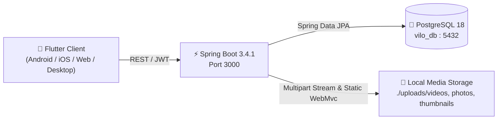

# Vilo App Domain Context & Feature Map

## App Concept

**Vilo** is a high-performance short-form content platform (similar to TikTok / Instagram Reels) with an integrated e-commerce shopping experience (product tagging on videos, showcase store, in-app cart and checkout), intentionally excluding live video broadcasting.

---

## Architecture Topology

---

## Feature Modules

1. **`feed/`**:
   - Vertical short-form video feed (`VideoFeedPage`, `HomeFeedPage`, `CommunityFeedPage`).
   - Caching layer (`FeedRemoteDataSource._feedCache` and `_userVideosCache`).
   - Interactive overlays: author username, verified badge, colored hashtag spans, spinning audio disc, interactive like/save/comment buttons, and `_AnimatedFollowButton` with spring physics and morphing checkmark.
   - Dynamic layout positioning: responsive bottom offsets (`infoBottom`, `actionButtonsBottom`) adapting to floating dock vs standalone fullscreen viewer.
   - Edge-aligned controls (`right: 8`) and sound toggle button placed safely below the top category navbar (`padding.top + 64pt`).
   - Dual upload sheet (`UploadVideoSheet`) for both videos and image/photo posts with tags and thumbnail preview.
   - `HomeFeedPage` with edge-fading horizontal scrollable category bar (`Community`, `Following`, `For You`, `Shop`) via `ShaderMask` and `BouncingScrollPhysics`.
   - Fullscreen video playback modal with back button navigation.
2. **`profile/`**:
   - User & creator profiles (`ProfileScreen`, `PublicProfileScreen`).
   - Global real-time synchronization bus (`ProfileSyncService`) broadcasting `videoUploadedEvents`, `videoInteractionEvents`, `videoDeletedEvents`, and `followEvents`.
   - Content tabs: `Music` (Tab 0 on left), `Grid / Posted Videos` (Tab 1 on right of music), `Shop` (Tab 2), `Saved` (Tab 3), and `Liked` (Tab 4).
   - Powered by `ViloTabBarView` eliminating Flutter `NestedScrollView` zero-width viewport index clamping bugs.
   - Video deletion restricted strictly to current user's posted videos (`canDelete: true` on Tab 1 only).
   - Thought Stories Balloon & sunset gradient ring synchronized with `InboxScreen`.
   - "People You May Know" suggestions (`PeopleScreen`) and Followers/Following management (`FollowersFollowingScreen`).
3. **`shop/`**:
   - Integrated store catalog (`ShopPage`), product detail view (`ProductDetailPage`), variant selection, and cart (`CartPage`).
4. **`creator/`**:
   - Studio camera recording, gallery media picker, video trimming, and shop product tagging.
5. **`search_discover/`**:
   - Universal search (`SearchScreen`) with category filtering (Top, Accounts, Videos, Sounds, Shop) and persistent search history.
6. **`inbox_activity/`**:
   - Thought Stories Composer with 6 atmospheric color themes and animated equalizer waveforms.
   - Interactive `MusicPickerBottomSheet` & `MusicTrimmerBottomSheet` with duration selector wheel.
   - Activity notifications and direct 1-on-1 messaging (`ChatDetailScreen`).
7. **`bottom_nav/`**:
   - Floating Liquid Glass navigation dock with 5-phase viscous spring physics and scroll-driven compact morphing (`MainNavigationShell`).
