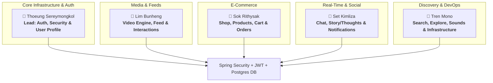

# Vilo Project — 5-Member Team Workload Distribution
> **Architecture**: Spring Boot 3.x (Spring Security, Spring Data JPA, WebSockets) + PostgreSQL + Flutter Mobile Client

---

## 🏗 High-Level Team Architecture



---

## 👥 Member Breakdown & Detailed Responsibilities

### 👤 Member 1: Thoeung Sereymongkol (Team Lead)
**Domain: Authentication, Spring Security & User Profile Management**

#### 1. Backend Responsibilities (Spring Boot):
- Configure **Spring Security 6** with **Stateless JWT** (Access Token + Refresh Token flow).
- Password hashing with `BCryptPasswordEncoder`.
- Implement `OncePerRequestFilter` (`JwtAuthenticationFilter`) and `SecurityFilterChain` (CORS and CSRF configurations).
- Role-based authorization (`ROLE_USER`, `ROLE_CREATOR`, `ROLE_ADMIN`).
- Provide core user authentication and profile REST endpoints:
  - `POST /api/v1/auth/register` — Create new account
  - `POST /api/v1/auth/login` — Authenticate and issue JWT pair
  - `POST /api/v1/auth/refresh` — Renew access token
  - `POST /api/v1/auth/logout` — Revoke / invalidate tokens
  - `GET /api/v1/users/me` — Current authenticated user profile
  - `GET /api/v1/users/{id}` — Public profile retrieval
  - `PUT /api/v1/users/me` — Update user profile & avatar
  - `POST /api/v1/users/{id}/follow` & `DELETE /api/v1/users/{id}/follow` — Follow / Unfollow

#### 2. PostgreSQL Schema & Database:
- **Tables**: `users`, `roles`, `user_roles`, `refresh_tokens`, `followers_following`.
- **Integrity**: Unique constraints on email/username, password hash length, foreign key cascades, audit timestamps (`created_at`, `updated_at`).

#### 3. Flutter Client Integration:
- Implement `AuthRemoteDataSource`, `TokenStorage` (using `flutter_secure_storage`).
- Configure HTTP/Dio interceptor to attach `Authorization: Bearer <token>` and auto-trigger token refresh on `401 Unauthorized`.
- Connect Login, Register, Profile, and Edit Profile views.

---

### 👤 Member 2: Lim Bunheng
**Domain: Video Engine, Feed Streaming & Social Post Interactions**

#### 1. Backend Responsibilities (Spring Boot):
- Paginated video feeds (Infinite scrolling with Pageable):
  - `GET /api/v1/videos/feed` — Algorithm / Chronological video feed
  - `GET /api/v1/videos/{id}` — Single video details
  - `POST /api/v1/videos/upload` — Upload video metadata & media files (Local disk / S3 / MinIO)
  - `DELETE /api/v1/videos/{id}` — Delete video (owner only)
- Interaction REST Endpoints:
  - `POST /api/v1/videos/{id}/like` & `DELETE /api/v1/videos/{id}/like` — Toggle Like
  - `POST /api/v1/videos/{id}/save` & `DELETE /api/v1/videos/{id}/save` — Toggle Bookmark / Save
  - `GET /api/v1/videos/{id}/comments` — List comments (supports nested replies)
  - `POST /api/v1/videos/{id}/comments` — Post a new comment
  - `POST /api/v1/videos/{id}/view` — Increment view count asynchronously

#### 2. PostgreSQL Schema & Database:
- **Tables**: `videos`, `video_likes`, `video_saves`, `comments`, `video_tags`.
- **Optimization**: Indexes on `(creator_id, created_at)` for feed queries and unique constraints on `(user_id, video_id)` for likes/saves.

#### 3. Flutter Client Integration:
- Connect `VideoFeedPage` and `CommunityFeedPage` to consume real paginated backend feeds.
- Hook up dynamic like/save counters, real-time comment bottom-sheet submission, and view counters.

---

### 👤 Member 3: Sok Rithysak
**Domain: E-Commerce Storefront, Products, Cart & Order System**

#### 1. Backend Responsibilities (Spring Boot):
- Product Catalog & Category APIs:
  - `GET /api/v1/products` — List all products with filtering (price, category, rating)
  - `GET /api/v1/products/{id}` — Product detail with images and creator store info
  - `GET /api/v1/categories` — Product categories list
  - `GET /api/v1/products/by-video/{videoId}` — Linked products featured in a short video
- Cart & Checkout Workflow:
  - `GET /api/v1/cart` — Get current user's cart items
  - `POST /api/v1/cart/items` — Add product to cart
  - `PUT /api/v1/cart/items/{itemId}` — Update item quantity
  - `DELETE /api/v1/cart/items/{itemId}` — Remove item from cart
  - `POST /api/v1/orders/checkout` — Place order with `@Transactional` stock reservation
  - `GET /api/v1/orders/history` — User order history
  - `GET /api/v1/orders/{id}` — Order status & tracking details

#### 2. PostgreSQL Schema & Database:
- **Tables**: `products`, `categories`, `product_images`, `cart_items`, `orders`, `order_items`.
- **Integrity**: `DECIMAL(10, 2)` for monetary values, foreign keys for cascade order items, status enums (`PENDING`, `PAID`, `SHIPPED`, `DELIVERED`, `CANCELLED`).

#### 3. Flutter Client Integration:
- Connect Profile Shop tab, floating product tags on video cards, shopping cart bottom sheet, and checkout summary screens.

---

### 👤 Member 4: Set Kimliza
**Domain: Real-Time Chat, 24h Stories/Thoughts & Notification Hub**

#### 1. Backend Responsibilities (Spring Boot):
- **Real-Time Communication**:
  - Configure **WebSocket with STOMP** (`/ws-vilo`) for direct messaging.
  - REST endpoints for message history & conversations:
    - `GET /api/v1/chats/conversations` — List active conversation threads
    - `GET /api/v1/chats/{userId}/messages` — Paginated message history with a user
    - `POST /api/v1/chats/{userId}/messages` — Send message (REST fallback)
- **24-Hour Thought / Story Status**:
  - `GET /api/v1/stories/active` — Fetch active stories (< 24h) from followed users
  - `POST /api/v1/stories` — Post a new text/audio/photo thought story
  - `POST /api/v1/stories/{id}/view` — Record story viewer
  - `GET /api/v1/stories/{id}/viewers` — Get viewers list
- **Notification Hub**:
  - `GET /api/v1/notifications` — Activity feed (likes, comments, new followers, system alerts)
  - `PUT /api/v1/notifications/{id}/read` — Mark notification as read
  - `GET /api/v1/notifications/unread-count` — Unread count for bottom bar badge

#### 2. PostgreSQL Schema & Database:
- **Tables**: `conversations`, `messages`, `thought_stories`, `story_views`, `notifications`.
- **Indexes**: Composite index on `(thought_stories.user_id, thought_stories.expires_at)` and `messages.created_at`.

#### 3. Flutter Client Integration:
- Connect WebSocket STOMP client in Flutter for live chatting.
- Connect Story viewers bottom sheet, story creator sheet, and notification hub tabs.

---

### 👤 Member 5: Tren Mono
**Domain: Search & Discovery, Sound/Audio Library, DevOps & Swagger Documentation**

#### 1. Backend Responsibilities (Spring Boot):
- **Search & Discovery**:
  - `GET /api/v1/search?q={query}&type={all|users|videos|sounds|products}` — Global search endpoint
  - `GET /api/v1/explore/trending` — Trending hashtags and trending video algorithm
- **Sound & Audio Library**:
  - `GET /api/v1/sounds/trending` — List popular sounds for video creation
  - `GET /api/v1/sounds/{id}` — Sound metadata (duration, waveform, artist)
  - `GET /api/v1/sounds/{id}/videos` — Videos that use this sound
- **DevOps, Standards & Infrastructure**:
  - Setup **OpenAPI 3 / Swagger UI** (`springdoc-openapi-starter-webmvc-ui`) at `/swagger-ui.html`.
  - Global Exception Handler (`@RestControllerAdvice`) returning standard `ProblemDetail` or custom `ApiResponse<T>`.
  - `docker-compose.yml` for local PostgreSQL 18 setup.

#### 2. PostgreSQL Schema & Database:
- **Tables**: `sounds`, `hashtags`, `video_hashtags`, `search_history`.
- **Full-Text Search**: Add PostgreSQL `GIN` / `tsvector` indexes on `users(username, display_name)` and `videos(title, caption)`.

#### 3. Flutter Client Integration:
- Connect Search & Discover screen (live debounce search, search history, category filter chips).
- Connect Sound Detail page and Audio Trimmer / Music Picker bottom sheets.

---

## 📊 Quick Summary Matrix

| Member | Feature Domain | Key Backend Modules | Database Tables | Flutter Target Screens |
| :--- | :--- | :--- | :--- | :--- |
| **Thoeung Sereymongkol** *(Lead)* | **Auth & Security** | Spring Security 6, JWT, User CRUD, Following | `users`, `roles`, `refresh_tokens`, `followers` | Login, Register, Profile, Edit Profile |
| **Lim Bunheng** | **Video & Feed Engine** | Video Streaming, Likes, Saves, Comments, Views | `videos`, `video_likes`, `video_saves`, `comments` | Video Feed, Community Feed, Comments Sheet |
| **Sok Rithysak** | **E-Commerce & Orders** | Products, Categories, Cart, Order Checkout | `products`, `categories`, `cart_items`, `orders` | Shop Tab, Cart, Checkout, Product Detail |
| **Set Kimliza** | **Chat & Real-Time** | WebSocket/STOMP, 24h Stories, Notifications | `conversations`, `messages`, `stories`, `notifications` | Inbox, Chat Detail, Story Bottom Sheet |
| **Tren Mono** | **Search, Sounds & DevOps** | Global Search, Sounds, Swagger UI, Global Errors | `sounds`, `hashtags`, `video_hashtags`, `search_history` | Search & Discover, Sound Detail, Music Picker |

---

## 📦 Standard API Response Format

All backend controllers should follow a unified response wrapper:

```json
{
  "success": true,
  "message": "Operation completed successfully",
  "data": { ... },
  "timestamp": "2026-10-08T09:38:00Z"
}
```

Error response wrapper:
```json
{
  "success": false,
  "message": "Invalid credentials or token expired",
  "error": "UNAUTHORIZED",
  "status": 401,
  "timestamp": "2026-10-08T09:38:00Z"
}
```
